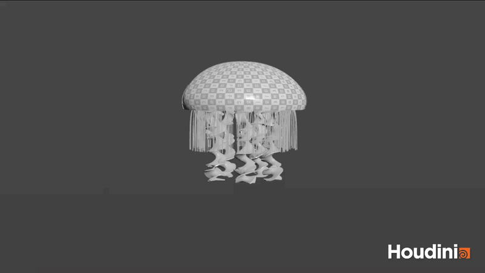
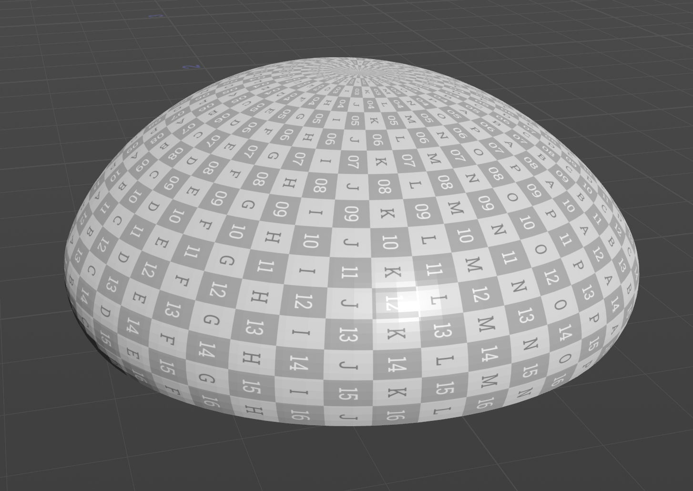
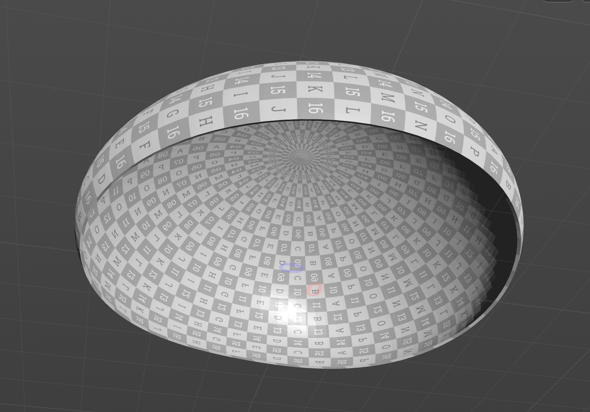
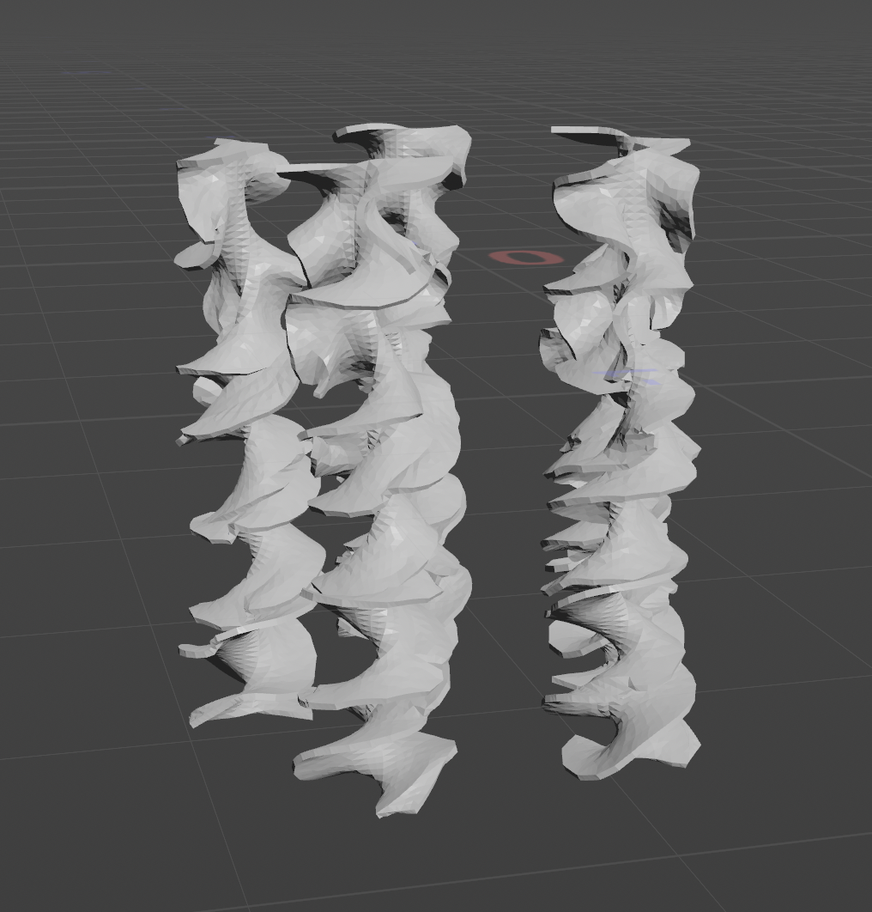
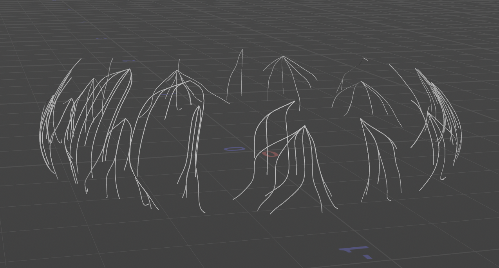
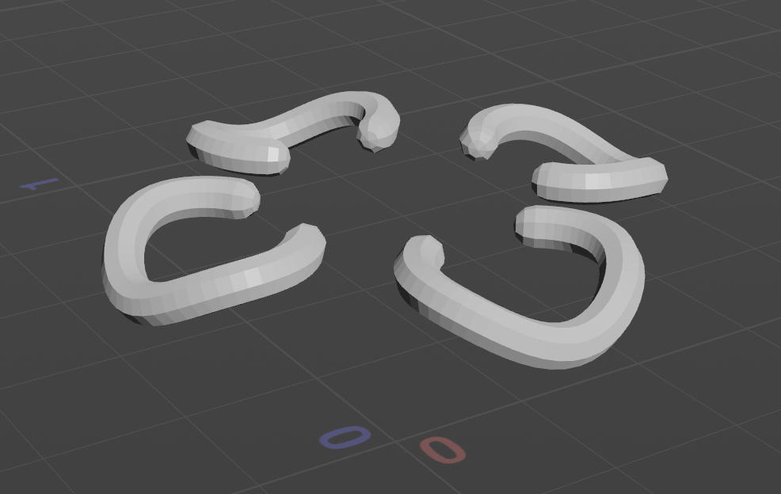
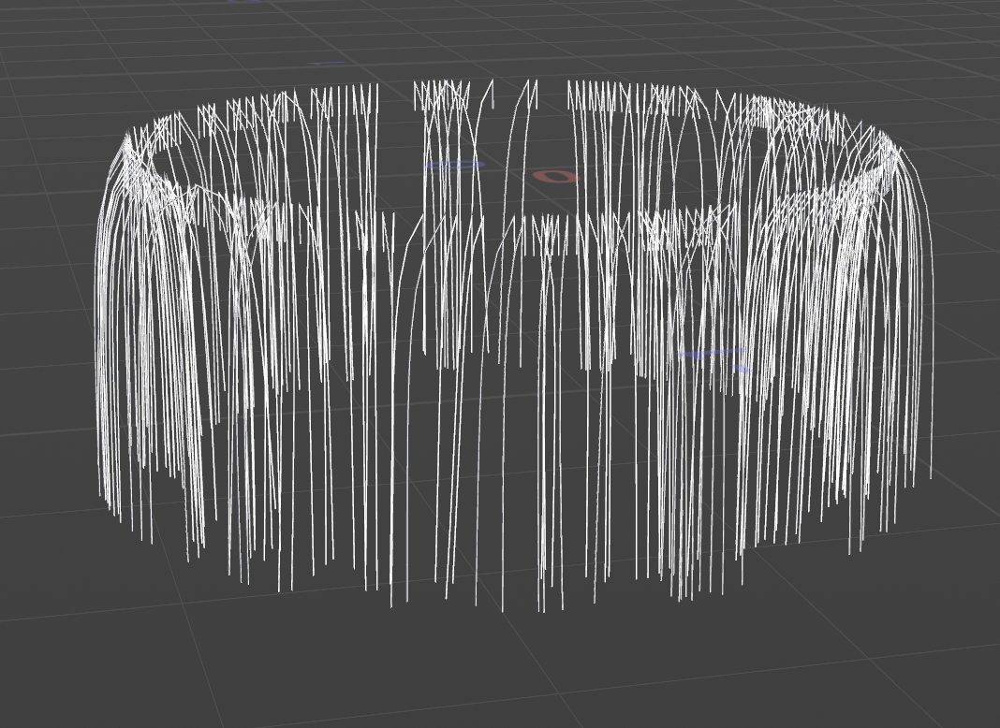

**University of Pennsylvania, CIS 5660: Procedural Graphics,
Homework 3**

- Bryce Joseph
- [Website](https://brycejo.com/), [LinkedIn](https://www.linkedin.com/in/brycejoseph/), [GitHub](https://github.com/brycej217)
- Tested on: Windows 11, Intel(R) CORE(TM) Ultra 9 275HX @ 2.70GHz 32.0GB, NVIDIA GeFORCE RTX 5080 Laptop GPU 16384MB

# CIS 5660 Homework 3: _Houdini Jellyfish_

<video width="640" height="360" controls>

  <source src="images/jelly.mp4" type="video/mp4">
</video>

# Overview

This project involved creating a procedural jellyfish model and animation using Houdini.

# Features

## Bell

The jellyfish bell (or body) was made using a circle and sweep node, along with some noise, following this [tutorial](https://www.youtube.com/watch?v=J3X8BB0yNRE).

## Arms

The jellyfish arms was made using grid geometry and a vellum cloth simulation, following this [tutorial](https://www.youtube.com/watch?v=A_oNXqx8XH4).

## Veins

The veins of the jellyfish were made by scattering points along the jellyfish surface and utilizing the shortest path node to create lines.

## Organs

The organs of the jellyfish were made using circle nodes, extrude nodes, and copy transform nodes.

## Tentacles

The tentacles of the jellyfish were made by scattering lines onto points along an arc then utilizing a vellum hair simulation, following this [tutorial](https://www.youtube.com/watch?v=LN4XXaHQkmU).
